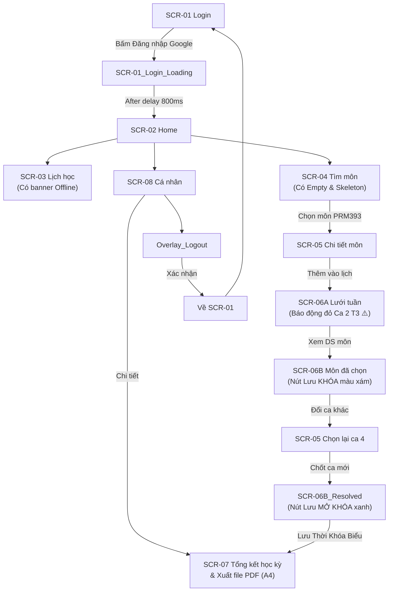

# Handoff 2 — EduPlan Mobile (Flutter) — Warm Paper Academic Edition

Tài liệu đặc tả kỹ thuật giao diện dành cho lập trình viên Flutter, chuyển giao trực tiếp từ thiết kế Figma & Google Stitch.

| Thông số | Giá trị chuẩn |
| --- | --- |
| Màn hình chuẩn | **390 × 800 dp** (Android Mobile — Đã thống nhất & duyệt đồng bộ) |
| Design System | Material Design 3 (Custom Warm Paper Academic System) |
| Theme Mode | Warm Paper / Cozy Parchment (Giảm độ chói, tối ưu đọc lịch học kéo dài) |
| Typography | Inter (Hỗ trợ 100% tiếng Việt, Tabular Numbers cho giờ học) |
| Quy chuẩn màn hình | 9 màn hình chính + 3 biến thể State + 1 Modal Overlay + 1 Intermediate Loading |

---

## Mục lục

- [Phần 1 — Bảng ánh xạ Design Tokens sang Flutter](#phần-1--bảng-ánh-xạ-design-tokens-sang-flutter)
  - [1.1. Bảng màu (ColorScheme)](#11-bảng-màu-colorscheme)
  - [1.2. Kiểu chữ (TextTheme - Font Inter)](#12-kiểu-chữ-texttheme---font-inter)
  - [1.3. Spacing, Border Radius & Elevation](#13-spacing-border-radius--elevation)
  - [1.4. Bảng ánh xạ Component sang Flutter Widget](#14-bảng-ánh-xạ-component-sang-flutter-widget)
- [Phần 2 — Đặc tả chi tiết các màn hình & States](#phần-2--đặc-tả-chi-tiết-các-màn-hình--states)
  - [2.0. Tổng quan luồng điều hướng (Navigation Architecture)](#20-tổng-quan-luồng-điều-hướng-navigation-architecture)
  - [2.1. SCR-01 — Login Screen & SCR-01_Loading](#21-scr-01--login-screen--scr-01_loading)
  - [2.2. SCR-02 — Home Dashboard](#22-scr-02--home-dashboard)
  - [2.3. SCR-03 — Weekly Schedule & Trạng thái Ngoại tuyến](#23-scr-03--weekly-schedule--trạng-thái-ngoại-tuyến)
  - [2.4. SCR-04 — Course Catalog, Loading & Empty State](#24-scr-04--course-catalog-loading--empty-state)
  - [2.5. SCR-05 — Course Detail (Chi tiết môn & Chọn lớp)](#25-scr-05--course-detail-chi-tiết-môn--chọn-lớp)
  - [2.6. SCR-06A — Plan Builder Grid (Lưới tuần & Báo động trùng)](#26-scr-06a--plan-builder-grid-lưới-tuần--báo-động-trùng)
  - [2.7. SCR-06B — Selected Courses & SCR-06B_Resolved (Khắc phục lỗi)](#27-scr-06b--selected-courses--scr-06b_resolved-khắc-phục-lỗi)
  - [2.8. SCR-07 — Semester Summary & Export PDF](#28-scr-07--semester-summary--export-pdf)
  - [2.9. SCR-08 — Profile & Settings & Overlay_Logout](#29-scr-08--profile--settings--overlay_logout)
- [Phần 3 — Responsive (width ≥ 600 dp) & Checklist QA](#phần-3--responsive-width--600-dp--checklist-qa)

---

## Phần 1 — Bảng ánh xạ Design Tokens sang Flutter

### 1.1. Bảng màu (ColorScheme)

```dart
// lib/theme/app_colors.dart
import 'package:flutter/material.dart';

class AppColors {
  // Nền canvas giấy kem ấm & thẻ ngà ấm
  static const Color canvasBg          = Color(0xFFFBF6EB); // Nền tổng thể Scaffold
  static const Color surfaceCard        = Color(0xFFFFFDF7); // Bề mặt Card, Sheet, App Bar
  static const Color surfaceLowest      = Color(0xFFFFFFFF); // Nền trắng input text
  static const Color borderStructural   = Color(0xFFEAE1D0); // Viền 1px nét liền quanh Card

  // Màu thương hiệu & Hành động chính (Royal Blue)
  static const Color primaryBlue        = Color(0xFF2563EB); // Nút CTA chính, Tab active
  static const Color primaryBluePressed = Color(0xFF1D4ED8); // Trạng thái nhấn nút
  static const Color primaryBlueTonal   = Color(0xFFDBE1FF); // Nền chip/tag nổi bật
  static const Color onPrimaryWhite     = Color(0xFFFFFFFF);

  // Màu văn bản (Độ tương phản cao trên nền kem)
  static const Color textPrimary        = Color(0xFF1C1917); // Deep Espresso Ink (Tiêu đề, tên môn)
  static const Color textSecondary      = Color(0xFF78716C); // Warm Slate Muted (Giảng viên, ca học)
  static const Color textDisabled       = Color(0xFF94A3B8); // Chữ khi control bị khóa

  // Trạng thái & Tiếp cận: Cảnh báo trùng ca & Lỗi
  static const Color dangerSurface      = Color(0xFFFEE2E2); // Nền banner báo trùng, ô lưới lỗi
  static const Color dangerBorder       = Color(0xFFDC2626); // Viền đỏ báo động, icon ⚠️
  static const Color dangerText         = Color(0xFFB91C1C); // Chữ đỏ thông báo lỗi

  // Trạng thái: Chờ, Nhắc nhở & Chip "Hôm nay"
  static const Color warningSurface     = Color(0xFFFEF3C7); // Nền tag "Đang học", nút Hôm nay
  static const Color warningBorder      = Color(0xFFFDE68A);
  static const Color warningText        = Color(0xFF78350F); // Chữ nâu đậm (WCAG AAA >= 7:1)

  // Trạng thái: Thành công & Hợp lệ
  static const Color successSurface     = Color(0xFFDCFCE7); // Nền xác nhận hợp lệ
  static const Color successBorder      = Color(0xFF16A34A);
  static const Color successText        = Color(0xFF15803D); // Chữ trạng thái kế hoạch hợp lệ
}
```

**Ánh xạ vào `ThemeData.colorScheme`:**

| colorScheme token | Ánh xạ hằng số Flutter | Vai trò trong hệ thống |
| --- | --- | --- |
| `colorScheme.surface` | `AppColors.canvasBg` | Nền Scaffold toàn app |
| `colorScheme.surfaceContainer` | `AppColors.surfaceCard` | Nền thẻ môn học, dialog, bottom bar |
| `colorScheme.surfaceContainerLowest` | `AppColors.surfaceLowest` | Nền ô nhập liệu search bar |
| `colorScheme.outlineVariant` | `AppColors.borderStructural` | Viền hairline 1px solid của mọi thẻ |
| `colorScheme.primary` | `AppColors.primaryBlue` | Màu nút chính, tab active, link chuyển tiếp |
| `colorScheme.onPrimary` | `AppColors.onPrimaryWhite` | Chữ trắng trên nền nút xanh |
| `colorScheme.onSurface` | `AppColors.textPrimary` | Tiêu đề, tên môn (tương phản >12:1) |
| `colorScheme.onSurfaceVariant` | `AppColors.textSecondary` | Giảng viên, phòng học, chú thích phụ |
| `colorScheme.error` | `AppColors.dangerBorder` | Viền đỏ lỗi, viền ô trùng ca |
| `colorScheme.errorContainer` | `AppColors.dangerSurface` | Nền ô Ca 2 Thứ 3 bị trùng lịch |

### 1.2. Kiểu chữ (TextTheme - Font Inter)

```dart
// lib/theme/app_typography.dart
import 'package:flutter/material.dart';
import 'app_colors.dart';

final TextTheme appTextTheme = TextTheme(
  headlineLarge: TextStyle(
    fontFamily: 'Inter', fontSize: 24, fontWeight: FontWeight.bold, height: 1.3,
    letterSpacing: -0.015, color: AppColors.textPrimary,
  ),
  headlineMedium: TextStyle(
    fontFamily: 'Inter', fontSize: 20, fontWeight: FontWeight.w600, height: 1.3,
    letterSpacing: -0.01, color: AppColors.textPrimary,
  ),
  titleMedium: TextStyle(
    fontFamily: 'Inter', fontSize: 16, fontWeight: FontWeight.w600, height: 1.4,
    color: AppColors.textPrimary,
  ),
  bodyLarge: TextStyle(
    fontFamily: 'Inter', fontSize: 16, fontWeight: FontWeight.normal, height: 1.5,
    color: AppColors.textPrimary,
  ),
  bodyMedium: TextStyle(
    fontFamily: 'Inter', fontSize: 14, fontWeight: FontWeight.normal, height: 1.4,
    color: AppColors.textPrimary, // Tối thiểu 14sp theo chuẩn WCAG
  ),
  bodySmall: TextStyle(
    fontFamily: 'Inter', fontSize: 12, fontWeight: FontWeight.normal, height: 1.3,
    color: AppColors.textSecondary,
  ),
  labelLarge: TextStyle(
    fontFamily: 'Inter', fontSize: 14, fontWeight: FontWeight.w600, height: 1.4,
    color: AppColors.onPrimaryWhite,
  ),
  labelMedium: TextStyle(
    fontFamily: 'Inter', fontSize: 12, fontWeight: FontWeight.w600, height: 1.3,
    color: AppColors.textSecondary,
  ),
  labelSmall: TextStyle(
    fontFamily: 'Inter', fontSize: 11, fontWeight: FontWeight.w600, height: 1.2,
    letterSpacing: 0.04, color: AppColors.textSecondary,
  ),
);

// Tabular numbers cho giờ học và mã phòng
const TextStyle tabularNumberStyle = TextStyle(
  fontFamily: 'Inter',
  fontFeatures: [FontFeature.tabularFigures()],
);
```

### 1.3. Spacing, Border Radius & Elevation

```dart
// lib/theme/app_dimens.dart
class AppSpacing {
  static const double xs  = 4.0;
  static const double sm  = 8.0;
  static const double md  = 12.0;
  static const double lg  = 16.0;  // Padding ngang chuẩn của màn hình 390dp
  static const double xl  = 24.0;
  static const double xxl = 32.0;

  static const double bottomClearanceWithBar    = 96.0;  // Tránh bị Bottom Bar 64dp đè
  static const double bottomClearanceDockedBtn  = 110.0; // Tránh bị Footer Button đè
}

class AppRadius {
  static const double control = 8.0;   // Nút bấm, TextField, tag nhỏ
  static const double card    = 16.0;  // Thẻ môn học, Modal Bottom Sheet, Dialog
  static const double pill    = 999.0; // Status chip, badge, avatar
}

class AppElevation {
  // Hệ thống hoàn toàn không dùng drop shadow mờ ảo, dùng border 1px làm phân tách
  static const Border sideBorder = Border.fromBorderSide(
    BorderSide(color: AppColors.borderStructural, width: 1.0),
  );
}
```

### 1.4. Bảng ánh xạ Component sang Flutter Widget

| Tên Component (Design) | Widget Flutter chuẩn | Variants / States hỗ trợ |
| --- | --- | --- |
| Button | `FilledButton` / `OutlinedButton` | Default, Pressed, Disabled, Loading (với Spinner) |
| Destructive Button | `FilledButton` (Nền đỏ) | Dùng cho hành động Đăng xuất hoặc Hủy môn |
| Text Field / Search | `TextFormField` / `SearchBar` | Default, Focused (viền xanh), Filled, Error, Disabled |
| Course Card | `Container` bọc `InkWell` | Default, Pressed, Conflict (viền đỏ + tag ⚠️) |
| Navigation Bar | `NavigationBar` (M3) | 4 Destinations, mỗi tab có variant Active / Inactive |
| Top App Bar | `AppBar` | Back Button 48dp, Title, Action icons |
| Modal Dialog | `AlertDialog` / `showGeneralDialog` | Confirm (Hủy/Đồng ý) và Alert (Cảnh báo trùng/Lỗi) |
| Loading State | Skeleton / Shimmer | Screen-level skeleton card mờ xám |
| Empty State | Custom `EmptyStateWidget` | Minh họa + Tiêu đề + Phụ đề + Action Button |
| Error / Offline State | `MaterialBanner` / Thẻ cảnh báo | Nền đỏ/cam + Icon ⚠️ + Text nguyên nhân + Nút thử lại |

---

## Phần 2 — Đặc tả chi tiết các màn hình & States

### 2.0. Tổng quan luồng điều hướng (Navigation Architecture)

| Mã màn hình | Tên màn hình | Cấp bậc | Bottom Bar (64dp) | Điểm kết nối điều hướng |
| --- | --- | --- | --- | --- |
| SCR-01 | Login Screen | Root | ❌ Ẩn | Chuyển sang SCR-01_Loading ➔ SCR-02 |
| SCR-02 | Home Dashboard | Cấp 1 | ✅ Tab Trang chủ | Mở SCR-03, SCR-04, SCR-08 |
| SCR-03 | Weekly Schedule | Cấp 1 | ✅ Tab Lịch học | Có state hiển thị cache Offline |
| SCR-04 | Course Catalog | Cấp 1 | ✅ Tab Tìm môn | Có Empty State & Skeleton Loading State; mở SCR-05 |
| SCR-05 | Course Detail | Cấp 2 | ❌ Ẩn | Chọn radio lớp mở ➔ Mở SCR-06A |
| SCR-06A | Plan Builder Grid | Cấp 2 | ❌ Ẩn | Lưới tuần mô phỏng, phát hiện trùng ➔ Mở SCR-06B |
| SCR-06B | Selected Courses | Cấp 2 | ❌ Ẩn | Nút Lưu bị khóa ➔ Bấm "Đổi ca" ➔ Mở SCR-05 |
| SCR-06B_Resolved | Selected Courses (Hết lỗi) | Cấp 2 | ❌ Ẩn | Nút Lưu MỞ KHÓA màu xanh ➔ Mở SCR-07 |
| SCR-07 | Semester Summary | Cấp 2 | ✅ Khôi phục | Mở Modal xem trước xuất PDF A4 |
| SCR-08 | Profile & Settings | Cấp 1 | ✅ Tab Cá nhân | Mở SCR-07 qua mục "Chi tiết >"; mở Overlay_Logout |
| Overlay_Logout | Dialog Xác nhận Đăng xuất | Overlay | N/A | Bấm Hủy (đóng overlay), Bấm Đăng xuất ➔ SCR-01 |

**Sơ đồ luồng điều hướng:**



### 2.1. SCR-01 — Login Screen & SCR-01_Loading

- **Layout:** `Scaffold(backgroundColor: AppColors.canvasBg)` → `SafeArea` → `Padding(16)` → `Column(mainAxisAlignment: MainAxisAlignment.spaceBetween)`.
- **Components:**
  - Master Logo EduPlan (sổ tay gáy xanh, 64×64 dp) + Tiêu đề "EduPlan" (28sp bold) + Slogan "Lên lịch học thật dễ!".
  - Nút `GoogleSignInButton`: Chiều cao 52 dp, nền `#FFFFFF`, viền `#EAE1D0`, bo góc 8dp, logo Google + text "Đăng nhập bằng Google".
- **States:**
  - **Default:** Hiển thị nút đăng nhập sẵn sàng bấm.
  - **Loading (SCR-01_Login_Loading):** Khi người dùng bấm nút, nút chuyển sang nền xanh hoặc trắng viền xanh với vòng quay `CircularProgressIndicator(strokeWidth: 2.5)` kèm chữ "Đang xác thực Google...".
- **Interactions & Navigation:** Bấm nút ➔ Kích hoạt trạng thái loading ➔ Sau 800ms (After delay) gọi `Navigator.pushReplacementNamed(context, '/home')` sang SCR-02.
- **Constraints:** Toàn bộ nội dung căn giữa màn hình theo chiều dọc, không cuộn.

### 2.2. SCR-02 — Home Dashboard

- **Layout:** `Scaffold` → `AppBar` cố định → `RefreshIndicator` → `SingleChildScrollView(padding: EdgeInsets.fromLTRB(16, 12, 16, 96))` → `Column(spacing: 16)`.
- **Components:**
  - Top App Bar: Logo EduPlan + subtitle "Trang Chủ", icon chuông thông báo, Avatar sinh viên Long (32×32 dp, viền `#EAE1D0`).
  - Hero Card "Lớp tiếp theo": Nền `#FFFDF7`, viền `#EAE1D0`, tag xanh "Lớp tiếp theo", đếm ngược "Bắt đầu trong 25p", môn Lập trình Di động (3 TC), phòng BE-302, nút CTA "Vào lớp" (48dp).
  - Lịch học sắp tới: Danh sách thẻ slot rút gọn kèm nút "Điểm danh" và "Sơ đồ phòng".
  - Bottom Navigation Bar (64dp, Tab 1 Trang chủ Active).
- **States:**
  - **Populated:** Đầy đủ dữ liệu học tập trong ngày.
  - **Offline Mode:** Xuất hiện thanh micro-banner màu cam nhạt ngay dưới AppBar: "Dữ liệu ngoại tuyến • Đã lưu lúc 09:15".
- **Interactions & Navigation:**
  - Kéo xuống để refresh (Pull-to-refresh).
  - Chạm Hero Card ➔ Mở SCR-05 Course Detail.
  - Chạm Bottom Bar ➔ Chuyển sang SCR-03, SCR-04, SCR-08.

### 2.3. SCR-03 — Weekly Schedule & Trạng thái Ngoại tuyến

- **Layout:** `Scaffold` → `AppBar("Lịch Học")` → Header cố định (Tuần + Dải 7 ngày) → `Expanded` → `ListView.builder(padding: EdgeInsets.only(bottom: 96))`.
- **Components:**
  - Thanh chọn tuần: `< Tháng 10, 2024 (Tuần 8) >` + Nút `[Hôm nay]` (Nền `#FEF3C7`, viền `#FDE68A`, chữ `#78350F`).
  - Dải 7 ngày (Horizontal swipe): Ngày active tô nền `#2563EB` chữ trắng bo tròn.
  - Thẻ ca học: Nền `#FFFDF7`, viền `#EAE1D0`. Ca đang diễn ra có vạch chỉ báo xanh 4dp mép trái.
- **States:**
  - **Default:** Hiển thị danh sách ca học từ Ca 1 đến Ca 5.
  - **SCR-03_Offline_Error (Error State):** Banner màu cam/đỏ nhạt nằm dưới Header: "⚠️ Mất kết nối mạng. Đang hiển thị lịch học ngoại tuyến đã lưu." + Nút "Thử lại" (touch target 48dp).
- **Navigation:** Nút Back `[←]` trên AppBar gọi `Navigator.pop(context)` quay lại màn hình trước.

### 2.4. SCR-04 — Course Catalog, Loading & Empty State

- **Layout:** `Scaffold` → `AppBar("Tìm Môn")` → SearchBar & Filter Chips cố định → `Expanded` → `ListView.separated(padding: EdgeInsets.only(bottom: 96))`.
- **Components:**
  - SearchBar: Cao 48 dp, bo góc 8 dp, nền `#FFFDF7`, placeholder "Tìm mã môn hoặc tên môn...".
  - Filter Chips: Chuyên ngành, Cơ sở, Tự chọn (ngang, cuộn được).
  - Thẻ môn học: `InkWell` toàn diện, nút phụ bên phải "Xem lớp (3)" (Cao 40dp, touch target 48dp).
- **States:**
  - **Populated:** Danh sách các môn học mở trong học kỳ (PRM393, SWE302, v.v.).
  - **SCR-04_Loading (Loading State):** Khung Skeleton Shimmer màu xám nhạt `#EAE1D0` thay thế toàn bộ danh sách thẻ môn khi đang fetch dữ liệu.
  - **SCR-04_Empty (Empty State):** Khi tìm kiếm không có kết quả (VD: gõ "XYZ99"): Cụm Icon kính lúp buồn (48×48 dp) + Text "Không tìm thấy môn học nào" + Phụ đề "Vui lòng thử từ khóa khác" + Nút `OutlinedButton` "Xóa bộ lọc".
- **Navigation:** Chạm vào bất kỳ vị trí nào trên thẻ môn PRM393 ➔ `Navigator.pushNamed('/course-detail')` sang SCR-05.

### 2.5. SCR-05 — Course Detail (Chi tiết môn & Chọn lớp)

- **Layout:** `Scaffold` → `AppBar(Back [←], Logo EduPlan, Ghim)` → `SingleChildScrollView(padding: EdgeInsets.only(bottom: 110))` → `DockedActionFooter` (cố định đáy).
- **Quy tắc điều hướng:** ẨN HOÀN TOÀN Bottom Navigation Bar.
- **Components:**
  - Thông tin môn: Lập trình Di động (PRM393), badge "3 Tín chỉ", tag "Tiên quyết: Đạt ✅".
  - Radio Group chọn lớp mở: Danh sách 3 lớp (SE1801, SE1802, SE1803) hiển thị ca, thứ, phòng, giảng viên. Thẻ được chọn có viền xanh `#2563EB`.
  - Docked Footer: Nút Yêu thích (`IconButton` 48dp) + Nút chính "Thêm vào lịch học" (`FilledButton` cao 52dp, nền `#2563EB`, bo góc 8dp).
- **Interactions & Navigation:**
  - Chọn lớp SE1801 ➔ Bấm "Thêm vào lịch học" ➔ `Navigator.pushNamed('/plan-builder-grid')` sang SCR-06A.
  - Nút Back `[←]` ➔ Quay lại SCR-04.

### 2.6. SCR-06A — Plan Builder Grid (Lưới tuần & Báo động trùng)

- **Layout:** `Scaffold` → `AppBar("Xếp Lịch Học Thử", Back [←])` → `SingleChildScrollView(padding: EdgeInsets.only(bottom: 110))` → `DockedBottomButton` (cố định đáy).
- **Quy tắc điều hướng:** ẨN HOÀN TOÀN Bottom Navigation Bar.
- **Components & Xử lý xung đột (Conflict Handling):**
  - Banner báo động trùng (Conflict Banner): Nền đỏ `#FEE2E2`, viền `#DC2626`, icon ⚠️, dòng chữ: "Trùng ca 2 Thứ 3! IAE201 trùng ca với PRM393" + Nút bấm Đổi ca.
  - Ma trận thời khóa biểu 5×5 (T2 - T6, Ca 1 - Ca 5):
    - Ô bình thường: Nền `#FFFDF7`, viền `#EAE1D0`, hiển thị mã môn.
    - Ô xung đột (Ca 2 Thứ 3): Nền đỏ `#FEE2E2`, viền đỏ `#DC2626`, icon ⚠️ + chữ đậm "TRÙNG! Ca 2".
  - Docked Button đáy: Nút lớn "Xem danh sách môn (4 môn • 12 TC) ➔" (Cao 52dp, nền `#2563EB`).
- **Navigation:** Chạm vào Banner hoặc nút chân trang ➔ Mở SCR-06B.

### 2.7. SCR-06B — Selected Courses & SCR-06B_Resolved (Khắc phục lỗi)

- **Layout:** `Scaffold` → `AppBar("Môn Đã Chọn", Back [←])` → `ListView(padding: EdgeInsets.only(bottom: 110))` → `DockedBottomButton`.
- **Quy tắc điều hướng:** ẨN HOÀN TOÀN Bottom Navigation Bar.
- **2 Trạng thái cốt lõi (Core UX Recovery):**
  - **Trạng thái 1 — SCR-06B_Selected_Courses (Khi còn lỗi trùng ca):**
    - Thẻ môn An toàn Thông tin (IAE201) viền đỏ `#DC2626`, tag đỏ "Trùng lịch Ca 2 T3".
    - Có nút hành động: `[⇄ Đổi ca khác]` (`OutlinedButton` đỏ, cao 40dp, touch target 48dp) và icon thùng rác 🗑️.
    - Nút chân trang "Lưu Thời Khóa Biểu": **BỊ KHÓA (Disabled)**, nền xám `#EAE1D0`, chữ `#78716C`, có icon ổ khóa 🔒, nhãn: "Giải quyết 1 môn trùng để lưu". Người dùng bấm vào không có tác dụng (Error Prevention).
  - **Trạng thái 2 — SCR-06B_Resolved (Sau khi đã đổi ca thành công):**
    - Banner trên cùng đổi thành: "✅ 0 môn bị trùng ca học".
    - Thẻ môn IAE201 trở về trạng thái viền xám bình thường `#EAE1D0`, tag đổi thành lịch học mới (Ca 4 T2, T5).
    - Nút chân trang: MỞ KHÓA HOÀN TOÀN (Active), nền xanh `#2563EB`, nhãn: "Lưu Thời Khóa Biểu" (chữ trắng `#FFFFFF`).
- **Interactions & Navigation:**
  - Tại SCR-06B: Bấm nút `[⇄ Đổi ca khác]` ➔ Chuyển sang SCR-05 Course Detail để chọn ca mới.
  - Sau khi chọn ca 4 không trùng ở SCR-05 ➔ Chuyển sang SCR-06B_Resolved.
  - Tại SCR-06B_Resolved: Bấm nút "Lưu Thời Khóa Biểu" (xanh) ➔ `Navigator.pushNamedAndRemoveUntil('/summary', ModalRoute.withName('/home'))` sang SCR-07.

### 2.8. SCR-07 — Semester Summary & Export PDF

- **Layout:** `Scaffold` → `AppBar("Tổng Kết Kế Hoạch")` → `SingleChildScrollView(padding: EdgeInsets.fromLTRB(16, 12, 16, 96))` → `NavigationBar` (Khôi phục Bottom Bar, tab Tìm môn Active).
- **Components:**
  - Hero KPI Card: 5 Môn học • 15 Tín chỉ, tag xanh "Kế hoạch hợp lệ ✅", học phí dự kiến "14.250.000 đ".
  - Danh sách 5 môn đã xác nhận kèm dấu tích xanh ✅.
  - Cụm nút hành động:
    - Nút chính: "📄 Xuất file PDF (A4)" (`FilledButton` cao 52dp, nền `#2563EB`, bo góc 8dp).
    - Hai nút phụ: "Đồng bộ Google Calendar" và "Chia sẻ ảnh TKB".
- **Interactions & Navigation:**
  - Bấm "Xuất file PDF (A4)" ➔ Kích hoạt tiến trình tạo file và mở Modal Bottom Sheet / Dialog xem trước bản in khổ A4 (tỷ lệ chuẩn 1 : 1.414).
  - Màn hình này cũng được mở trực tiếp từ mục "Chi tiết >" của thẻ Học kỳ Fall 2024 ở SCR-08.

### 2.9. SCR-08 — Profile & Settings & Overlay_Logout

- **Layout:** `Scaffold` → `AppBar("Cá Nhân")` → `SingleChildScrollView(padding: EdgeInsets.fromLTRB(16, 12, 16, 96))` → `NavigationBar` (Tab Cá nhân Active).
- **Components:**
  - Thông tin sinh viên: Avatar tròn 48dp, tên Trần Hoàng Long, MSSV SE180504 • K18 SE. Thẻ 15 Tín chỉ (HK 2) và GPA 3.42 (Giỏi).
  - Thẻ Học kỳ Fall 2024: Có nút Chi tiết > (màu xanh `#2563EB`, touch target 48dp).
  - Cài đặt ứng dụng: 3 switch toggle cao 56dp (Nhắc giờ học 15p, Tự động báo trùng lịch, Đồng bộ Google Calendar).
  - Nút nguy hiểm: `[-> Đăng xuất tài khoản` (Nền `#FEE2E2`, viền `#DC2626`, chữ đỏ `#DC2626`, cao 48dp).
- **Overlay Dialog — Overlay_Logout:**
  - Mở dạng Modal Dialog căn giữa màn hình (Centered) trên nền đen mờ 40% (`barrierColor: Colors.black40`).
  - Kích thước: Rộng 320dp, bo góc 16dp, nền `#FFFDF7`, viền 1px `#EAE1D0`, padding 20dp.
  - Tiêu đề: "Đăng xuất tài khoản?" (Inter SemiBold 18px).
  - Nội dung: "Bạn có chắc chắn muốn đăng xuất? Bạn sẽ cần đăng nhập lại bằng tài khoản trường để tiếp tục đồng bộ lịch học." (Inter Regular 14px, màu `#78716C`).
  - 2 nút hành động (cao 48dp, chia đều chiều rộng 50/50):
    - Nút "Hủy": `OutlinedButton`, nền `#FFFDF7`, viền `#EAE1D0`, chữ `#1C1917`. Bấm vào ➔ `Navigator.pop(context)` đóng dialog.
    - Nút "Đăng xuất": `FilledButton`, nền đỏ `#DC2626`, chữ trắng `#FFFFFF`. Bấm vào ➔ Xóa session và gọi `Navigator.pushNamedAndRemoveUntil('/login', (route) => false)` quay về SCR-01.

---

## Phần 3 — Responsive (width ≥ 600 dp) & Checklist QA

### 3.1. Quy tắc Responsive Tablet / Landscape (Width ≥ 600 dp)

- **Navigation Transition:** `NavigationBar` ở đáy màn hình tự động chuyển đổi thành `NavigationRail` cố định ở mép trái màn hình.
- **Content Centering & Max-Width:** Toàn bộ nội dung cuộn (Hero cards, Form đăng ký, Profile) bọc trong:

  ```dart
  Center(
    child: ConstrainedBox(
      constraints: const BoxConstraints(maxWidth: 540.0),
      child: contentWidget,
    ),
  )
  ```

- **Lưới xếp lịch (SCR-06A):** Trên màn hình rộng ≥ 600 dp, hiển thị cố định toàn bộ 5 cột ngày trong tuần (T2 - T6) song song mà không cần cuộn ngang.

### 3.2. Checklist nghiệm thu UI cho Flutter Developer (QA Checklist)

- [ ] **Màn hình chuẩn 390 × 800 dp:** Đảm bảo bố cục hiển thị vừa vặn trên màn hình chuẩn 390dp và co giãn tốt trên 412dp.
- [ ] **Bảng màu Warm Paper:** 100% Scaffold dùng nền `#FBF6EB`; thẻ dùng `#FFFDF7`; viền nét liền 1px `#EAE1D0`. Tuyệt đối không dùng nền trắng tinh gây chói mắt.
- [ ] **Độ tương phản tiếp cận (WCAG 2.1 AA/AAA):** Chữ nội dung tối thiểu 14sp; chữ tiêu đề đạt tương phản >12:1; nút `[Hôm nay]` dùng chữ nâu đậm `#78350F` trên nền vàng `#FEF3C7` (tương phản 7.2:1).
- [ ] **Kích thước vùng chạm (Touch Target):** Mọi nút bấm, icon button, radio item, filter chip có diện tích bấm tối thiểu 48 × 48 dp.
- [ ] **Quy tắc hiển thị Bottom Navigation Bar (64dp):**
  - HIỂN THỊ: SCR-02, SCR-03, SCR-04, SCR-07, SCR-08.
  - ẨN HOÀN TOÀN: SCR-01, SCR-05, SCR-06A, SCR-06B, SCR-06B_Resolved.
- [ ] **Bottom Clearance (Khoảng đệm an toàn):**
  - Màn hình có Bottom Bar: `padding-bottom: 96.0`.
  - Màn hình có Footer Button (SCR-05, 06A, 06B): `padding-bottom: 110.0` đến `120.0`.
- [ ] **Phòng ngừa & Phục hồi lỗi (SCR-06B & SCR-06B_Resolved):**
  - Nút "Lưu Thời Khóa Biểu" bị khóa mờ khi còn môn trùng lịch.
  - Có nút `[⇄ Đổi ca khác]` cạnh môn trùng để hoán đổi lịch tại chỗ.
  - Sau khi đổi ca thành công, nút Lưu sáng xanh `#2563EB` cho phép bấm tiếp.
- [ ] **Đầy đủ các States:** Có màn hình Loading (Spinner & Skeleton), Empty State (kính lúp tìm kiếm rỗng), Error Banner (offline/mất mạng), và Modal Dialog Overlay xác nhận đăng xuất.
